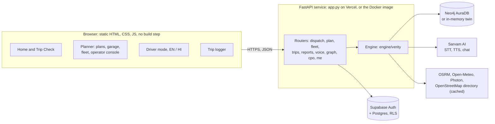
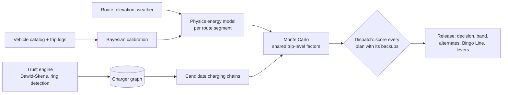

<div align="center">

# Verity

**Calibrated go / no-go dispatch for EV trips in India.**

Before a long drive, Verity answers *"Will I make it?"* with a decision, an arrival band whose coverage is measured
on held-out real trips, a divert threshold for every kilometre of the route, and a backup charger that does not share
the primary's failure modes. When the evidence is too thin, it refuses instead of guessing.

[**Live demo**](https://verity-three-pi.vercel.app/web/home.html) ·
[Trip planner](https://verity-three-pi.vercel.app/web/planner.html) ·
[Evaluation](#evaluation) · [Architecture](#architecture) · [Getting started](#getting-started) · [API](#api) ·
[Limitations](#limitations)

[](https://github.com/Ansh-Goyal01/verity/actions/workflows/ci.yml)


</div>

---

## Overview

A dashboard range figure is a single point estimate. It ignores AC load, wind, gradient, payload and driving style,
and it assumes the charger you are counting on is working. In India that last assumption fails often, and a driver
who is wrong is stranded on a highway.

Verity borrows the discipline of airline dispatch. Every trip gets a **release**: a decision a driver can act on, the
uncertainty behind it, and a plan B that holds when plan A fails.

| A release contains | What it is |
|---|---|
| **Decision** | `GO`, `NO_GO` or `INSUFFICIENT_EVIDENCE`, with a success probability from 1,500 Monte Carlo runs, rounded to 5% and never shown as 100% |
| **Arrival band** | p10 / p50 / p90 battery at the destination, from a physics model with shared trip-level uncertainty |
| **Charging plan** | Stops on the route, each with reachable **alternates** that do not share its site or operator |
| **Bingo Line** | The lowest battery level at each kilometre from which the next charger, a working alternate or the destination is still reachable at the driver's target confidence; below it, divert |
| **Point of no return** | The first kilometre from which returning to the last charger behind, or the origin, is no longer likely enough |
| **Levers** | What would raise confidence: a slower cruise, more charging minutes, another vehicle |
| **Audit trail** | Every plan is written to the charger graph, so `GET /api/graph/why/{plan_id}` explains it with the Cypher it ran |

### Example release

Real engine output of `POST /api/dispatch` for demo vehicle V12, Noida to Agra
([`docs/api_examples/dispatch_V12.json`](docs/api_examples/dispatch_V12.json)). The vehicle and its charger reports are
simulated and labelled `is_simulated: true`; the route, elevation, weather and charger directory are real.

```text
decision            GO
confidence          95%+            1,500 Monte Carlo runs, model estimate, never shown as 100%
route               190.8 km, 177 min
arrival battery     p10 13%   p50 19%   p90 23%
charging stop       Tata Power Yamuna Expressway Mathura RHS, km 118.6, 30 min
bingo line          59% at km 0  ->  17% at km 96  ->  10% at km 190.8
point of no return  km 66
reason              GO because backup EV charging station (OpenStreetMap) (95%+ likely to work, 10 reports)
                    is reachable 90% of the time.
```

### Try it in two minutes

1. Open the [live home page](https://verity-three-pi.vercel.app/web/home.html) and select **Try a charger outage**
   to replay a Noida to Agra trip in which the planned charger fails mid-route.
2. Open the [trip planner](https://verity-three-pi.vercel.app/web/planner.html#plan), keep Noida to Agra, pick a car
   and press **Compare plans**. Expand an option to see its arrival band and Bingo Line.
3. Open **Charger graph** to inspect a charger's reports, the sources behind them and their trust.
4. Open **Spoken trip** and say or type, in English or Hindi, *"from Noida to Agra tomorrow at 8 am, Nexon 45,
   70 percent, AC on, 3 people"*. Verity reads the request back and waits for confirmation before it plans.

No account is needed to plan, dispatch or explore the graph.

## Evaluation

Verity is judged on whether its uncertainty is honest, not only on its point estimate. Every number below is read from
a committed result file; REAL means an external recorded source, not a Verity field trial.

| Question | Data | n | Result |
|---|---|---|---|
| Does the 90% arrival band contain real outcomes? | REAL: public, self-reported Indian trips, held out by source page | 21 trips from 11 pages | Physics model **19 / 21** (Wilson 95% CI 71% to 97%). Pure ML regression 14 / 21 (45% to 83%) |
| How large is the point error? | Same held-out split | 5 range tests, 16 consumption reports | Range MAE **30.9 km** vs 137.6 km for the manufacturer's claimed range. Consumption MAE 25.9 Wh/km vs 57.8 Wh/km |
| Does dispatch with backups reduce stranding? | SIMULATED, 40% of chargers down | 200 trips | Fixed shortest-path plan 32.0% stranded, Verity dispatch **3.0%** |
| Does weighting reports by source trust help? | SIMULATED, 40% of chargers down | 200 trips | Reliability-blind planning 12.5% stranded, trust-aware **3.0%** |
| Is per-trip uncertainty modelled correctly? | SIMULATED | 540 trips | 90% band coverage: shared trip-level factors **91.8%**, independent per-segment sampling 27.6% |
| Does it transfer to real telemetry? | REAL: BMW i3 (TU Munich), held out, opened once | 19 trips, 399 km | Median per-trip SoC-drop error 0.95 points, but the 95% band covers only 47% of trips and usable capacity is biased -10.5%. Not validated |

How to read this:

- **The bands are the product.** On point error alone, a flat "claimed range minus 25%" rule is as good or better on
  this small held-out set (21.9 km, 26.1 Wh/km). What a rule of thumb cannot give is a band that holds: 19 of 21 for the
  physics model against 14 of 21 for an ML regression trained on the same 71 trips.
- **Bands are widened, never narrowed.** Split-conformal calibration on the 71 training trips gave k = 0.95; values
  below 1 are reported and not applied, so releases are never made more confident than the physics model.
- **Simulated results are the optimistic case.** The simulator shares the planner's physics family. They show the
  mechanism works, not how often it works on Indian roads.
- **The held-out splits are opened once.** `tests/test_bmw_heldout_lock.py` refuses a second final run, and the
  Indian split is by source page so no page appears in both training and test.

Indian trip corpus: 115 rows collected from published road tests and owner reports, 101 verified against their source,
92 evaluable (`data/corpus/trips_india.csv`, `results/e1_india_real.json`, `results/e7_honest_bands.json`). Full
provenance, intervals and the "do not claim" list are in [`docs/EVIDENCE.md`](docs/EVIDENCE.md).

### Evidence ledger

Generated from the saved result files by `uv run python scripts/export_readme_tables.py`; a test fails when it is
stale. The live version is `GET /api/evidence/ledger`. The corpus counts in the first table come from
`results/real_data_summary.json`, which was last generated on 19 November, before the corpus freeze; the E1-India and
E7 rows use the frozen corpus.

<!-- readme-tables:start (generated by scripts/export_readme_tables.py; do not edit) -->
| Real evidence | Count |
|---|---|
| Indian trips, hand-collected from public sources | 0 usable of 6 rows |
| Charger reports (corpus + app snapshots) | 0 + 69 |
| Open Charge Map check-ins | 0 (fetched) |
| App reviews, classified | 0 usable of 0 |
| Voice notes from real speakers | 0 (not run) |
| BMW i3 trips, held out, opened once (Germany, not India) | 19 trips, 399 km |

| Simulated (every chart says so) | Trips or worlds per scenario |
|---|---|
| E3 reliability-blind vs trust-aware planning | 200 |
| E4 dispatch vs fixed stops | 200 |
| E5 trust recovery | 20 |
| E5b ring detection without a time window | 20 |
| E6 operator-correlated outages | 300 |

| Result | Data | n | Outcome |
|---|---|---|---|
| E4 stranded trips, 0% chargers down | simulated | 200 trips | fixed plan 9.0% (5.8% to 13.8%), dispatch 3.5% (1.7% to 7.0%) |
| E4 stranded trips, 20% chargers down | simulated | 200 trips | fixed plan 22.0% (16.8% to 28.2%), dispatch 2.0% (0.8% to 5.0%) |
| E4 stranded trips, 40% chargers down | simulated | 200 trips | fixed plan 32.0% (25.9% to 38.8%), dispatch 3.0% (1.4% to 6.4%) |
| E3 stranded trips, 40% chargers down | simulated | 200 trips | reliability-blind 12.5%, trust-aware 3.0% |
| E2 the 90% arrival band covers the outcome | simulated | 540 trips | shared trip factors 91.8%, independent segments 27.6% |
| BMW i3 usable-capacity error | REAL (Germany) | 19 trips | -10.5%; truth inside the 95% interval: yes, inside the 80% interval: no |
| BMW i3 battery drop per trip | REAL (Germany) | 19 trips | median error 0.95 points; the 95% band covers 47.0% of trips |
| E7 90% band covers held-out Indian trips | REAL (India, self-reported) | 21 trips | physics 19/21 (71.1% to 97.4%); pure ML regression 14/21 (45.4% to 82.8%) |
| E7 conformal inflation k (training split, out of sample) | REAL (India, self-reported) | 71 trips | k = 0.95, applied 1.00 (bands are never narrowed); physics + learned correction covers 19/21 (71.1% to 97.4%) |
<!-- readme-tables:end -->

## Architecture



### The dispatch pipeline



### Engine modules

| Module | Responsibility |
|---|---|
| `physics.py` | Rolling resistance, grade, aerodynamic drag, inertia, regeneration and auxiliary load per segment, each reported separately |
| `catalog.py`, `vehicles.py` | 45 variants of 34 Indian-market EVs; every battery and mass figure carries a source URL |
| `calibrate.py`, `conformal.py`, `honest_bands.py` | Bayesian vehicle calibration and split-conformal band widening |
| `forecast.py` | Monte Carlo over driver, AC, payload, wind and capacity error, sampled once per simulated trip |
| `dispatch.py` | Candidate chains, alternates, Bingo Line, point of no return, levers, refusal |
| `routing.py`, `chargers.py`, `sites.py`, `substations.py` | Cached routing, elevation and weather; charger directory, site grouping, nearest-substation proximity |
| `trust/` | Source trust (Dawid-Skene), report-ring detection, and the Neo4j and in-memory graph behind one interface |
| `voice.py`, `plan_voice.py`, `ride_voice.py`, `report_voice.py` | Sarvam speech in and out, read-back and confirmation before any action |
| `india_eval.py`, `evidence.py` | Held-out evaluation on real trips and the evidence ledger |

### Design decisions

Every assumption and threshold is recorded with its reason in [`docs/DECISIONS.md`](docs/DECISIONS.md). The ones that
shape the system:

| Decision | Why |
|---|---|
| **Physics first, ML as the baseline to beat** | Every energy term is explainable to a driver and testable on its own. ML regression is kept as a comparison, and it under-covers on real trips |
| **Uncertainty is shared across a trip** | Driver style, AC, payload, wind and capacity error are drawn once per simulated trip. Drawing them per segment averages them away and makes long trips falsely confident (27.6% coverage instead of 91.8%) |
| **The graph proposes, the Monte Carlo decides** | Neo4j generates candidate chains and checks shared causes; every candidate is still scored end to end with its backups |
| **Backups must fail independently** | Chargers at the same site or under the same operator share a cause of failure, so they do not count as each other's backup |
| **Reports are weighted by who sent them** | Each source's reliability is estimated from how its reports agree with the others (Dawid-Skene); sources that agree with each other too often are flagged as a ring and down-weighted |
| **Refuse rather than guess** | Thin evidence returns `INSUFFICIENT_EVIDENCE`, never a number with false precision |
| **Every simulated value is labelled** | `is_simulated` is on every response, simulated data lives in `data/sim/`, and every chart built from it says so |
| **Degrade, don't fail** | No Neo4j credentials: an in-memory twin gives the same answers. No Sarvam key: voice answers 503 and the keypad works. `VERITY_OFFLINE=1`: packaged route caches, the memory graph and cached audio |

### How Neo4j is used

- Chargers, sites, operators, reports, sources and plans form one graph (`engine/verity/trust/graph.py`).
- **Independence of backups:** `SHARED_CAUSES_CYPHER` finds chargers that share a site or operator with the primary.
- **Candidate chains:** `chains_cypher` proposes charging sequences for the Monte Carlo to score.
- **Report rings:** Jaccard agreement edges between sources (`AGREEMENT_CYPHER`) expose accounts that always report
  together.
- **Auditability:** every plan is written back as a path; graph responses include the Cypher they ran and `query_ms`.
- Spoken charger names resolve through the `charger_names` full-text index.

### How Sarvam is used

- **Spoken trip and ride check** in Hindi or English (`POST /api/voice/plan`, `/api/voice/ride-check`). The request is
  read back and confirmed before anything is planned.
- **Spoken charger report** (`POST /api/voice/report`, then `/confirm`). It requires first-hand knowledge and consent,
  and writes to the graph only after confirmation.
- Voice calls are rate limited per client because every call is paid. Demo answers are cached as audio and used only
  when Sarvam is unreachable, marked `cached: true`.

### Accounts and roles

Supabase Auth issues sessions; the API verifies them and enforces five roles server-side with `require_role`:
`owner`, `driver`, `fleet_manager`, `cpo` (charging-point operator) and `admin`. Postgres holds profiles, cars, trips,
reports, fleet vehicles, operator claims, share links and an audit log, with row-level security on the account tables
(`migrations/`). Browser roles have no privileges on the private schema.

| Surface | What it offers |
|---|---|
| Trip planner | Compare plans, open a release and driver message, re-plan an expired release |
| Garage and trips (signed in) | Saved cars and trips, recorded arrivals, private share links, charger reports with receipts |
| Fleet | Booking check across managed vehicles |
| Operator console (`cpo`) | Claimed chargers, trust and reports, repairs, critical chargers, suspected rings, shared grid risk |
| Admin | Approve operator claims, run and reset the simulated ring attack |

## Getting started

**Prerequisites:** Python 3.11+ (CI and the pinned demo numbers use 3.13), [uv](https://docs.astral.sh/uv/), and
Node.js only for the frontend tests.

```bash
git clone https://github.com/Ansh-Goyal01/verity.git
cd verity
uv sync
uv run pytest -q
uv run start.py          # API on :8000, web pages on :5500, opens the site
```

Without any credentials the engine runs on the in-memory graph and the voice endpoints answer 503. Interactive API
docs are at `http://localhost:8000/docs` in development; they are disabled in production.

**Fully offline:**

```bash
VERITY_OFFLINE=1 uv run start.py
```

**Docker:**

```bash
docker build -t verity .
docker run --rm -p 8000:8000 -e VERITY_OFFLINE=1 verity
curl http://localhost:8000/api/health
```

### Configuration

Copy `.env.example` to `.env` (never committed). Everything is optional for a local run.

| Variable | Purpose |
|---|---|
| `NEO4J_URI`, `NEO4J_USERNAME`, `NEO4J_PASSWORD` | Neo4j AuraDB. `VERITY_GRAPH=memory` forces the in-memory twin |
| `SARVAM_API_KEY`, `SARVAM_*_MODEL` | Speech-to-text, text-to-speech and chat models |
| `SUPABASE_URL`, `SUPABASE_ANON_KEY`, `DATABASE_URL` | Accounts: Auth project and a TLS-verified Postgres connection |
| `VERITY_ENV=production` | Production error policy, no OpenAPI docs |
| `VERITY_CORS_ORIGINS` | Exact browser origins allowed to call the API; replaces the built-in list |
| `VERITY_TRUST_PROXY=1` | Only behind exactly one proxy that appends `X-Forwarded-For` |
| `VERITY_OFFLINE=1` | Packaged caches, memory graph, cached speech |
| `VERITY_N_RUNS` | Monte Carlo runs per forecast, default 1500 |

Reproduce every result from a clean state with `uv run python scripts/run_all.py` (simulated) and
`uv run python scripts/run_real_data.py` (real data). Every script and experiment is listed in
[`docs/ENGINE_NOTES.md`](docs/ENGINE_NOTES.md).

## API

60+ endpoints behind a versioned contract, [`docs/API_CONTRACT.md`](docs/API_CONTRACT.md), with a changelog for every
shape change. Every response carries `is_simulated`; errors are `{"error": "code", "message": "..."}`.

| Endpoint | Purpose |
|---|---|
| `POST /api/dispatch` | The release: decision, band, plan, alternates, Bingo Line, levers |
| `POST /api/plan` | Ranked plan options for a custom trip |
| `POST /api/ride-check` | Cab-driver check before accepting a ride, with an after-drop charging plan |
| `POST /api/forecast/update` | Re-forecast from a new mid-trip battery reading |
| `POST /api/fleet/booking` | Which vehicle in a fleet can take a booking |
| `GET /api/release/{id}` | A stored release and its driver message |
| `GET /api/chargers` | Chargers in a bounding box, with trust and evidence |
| `GET /api/graph/why/{plan_id}` | Why a plan was chosen, with the Cypher that chose it |
| `POST /api/reports/quick` | A signed-in charger report, idempotent, with a receipt |
| `POST /api/voice/plan` | Spoken trip request with read-back |
| `GET /api/evidence/ledger` | What is real, simulated and still missing |
| `GET /api/health` | Graph backend, node counts, whether the voice key is present |

```bash
curl https://verity-three-pi.vercel.app/api/health
```

## Quality

- **815 pytest test functions and 37 frontend tests** (`node --test tests/frontend_*.test.cjs`), run in CI on every push.
- **CI on Windows**, the platform the demo runs on, with no secrets: live-Neo4j parity tests skip, no paid call can be
  made.
- **Offline container smoke test:** CI builds the Docker image, runs it with networking disabled and checks health and a
  full dispatch.
- **Graph parity tests** pin the Neo4j and in-memory backends to the same answers when live credentials are present.
- **Pinned demo decisions:** the V07, V12 and V19 releases are asserted by tests, so a model change that flips a demo
  decision fails the build.
- **Security:** an ArgosX scan of the live site (21 November) scored 84 / 100 with 14 findings and none critical. Header
  findings were fixed and re-tested; see [`docs/security/REMEDIATION_LOG.md`](docs/security/REMEDIATION_LOG.md).
  Reports and voice are rate limited, writes need consent, and secrets live only in host settings.

## Deployment

The live site runs on Vercel: the root `app.py` serves the static pages and mounts the FastAPI app as one Python
function; `vercel.json` keeps tests, results, raw data and the held-out split out of the bundle. The same API also
ships as the Docker image for any container host.

Serverless trade-offs, measured or documented in [`docs/DEPLOY.md`](docs/DEPLOY.md):

- A cold start builds the engine (demo fleet calibration, trust, graph sync), so warm it before a demo with
  `sh scripts/warmup.sh https://verity-three-pi.vercel.app`.
- State is per instance: a `plan_id` created on one instance can 404 on another, and rate limits are not global.
- `results/` is not deployed, so `/api/evidence/ledger` returns nulls there.

Check a deployment without credentials:

```bash
uv run python scripts/verify_deployed_api.py https://verity-three-pi.vercel.app --public-only
```

## Repository layout

```text
engine/verity/       physics, catalog, calibration, forecast, dispatch, routing, chargers, voice, trust/
api/                 FastAPI app, routers, auth, service layer, contract models, db/
web/ logger/ design/ frontend: plain HTML, CSS and JS, no build step
experiments/         E1 to E7, F8: learning curve, calibration, trust, dispatch, rings, operator correlation, bands
scripts/             data import, benchmarks, exporters, migrations, deployment checks, run_all.py
data/                corpus/ (real, cited), sim/ (simulated), processed/, splits/, fleet/, audio_cache/
results/             every result file the README, the docs and the UI quote
migrations/          Postgres schema for accounts and trip observations
tests/               pytest suite and Node frontend tests
docs/                contract, decisions, evidence, deployment, security
```

## Limitations

- **Small real evaluation.** The Indian held-out set is 21 public, self-reported trips from 11 pages. SoC is reported in
  whole percent, and the Wilson intervals treat records as independent.
- **Point accuracy is not the edge.** A flat "claimed minus 25%" rule matches or beats Verity's point error on this set; the
  value is in calibrated bands, independent backups and refusal.
- **Demo vehicles are simulated.** V07, V12 and V19 and every demo charger report are simulated and labelled.
- **Range Passport is experimental.** On held-out BMW i3 telemetry its capacity estimate is 10.5% low and the 80%
  interval misses the truth.
- **Charger power is assumed.** Almost no directory charger has tagged power, so dispatch assumes 25 kW unless an
  operator snapshot gives a rated figure.
- **Some failure correlations are assumptions.** The operator-wide correlation (`BETA_OPERATOR`) is not measured, and
  experiment E6 shows it makes no clear difference to stranding.
- **Ring detection has a known miss.** A slow ring spread over ten days evades detection in E5.
- **Learning from user trips is captured, not applied.** `POST /api/trips/{id}/observation` screens measured sessions,
  but nothing feeds calibration yet (`calibration_applied: false`).
- **Voice is not measured on real speakers.** Accuracy has been tested on synthetic audio only.

## Roadmap

- Feed screened user trips into vehicle calibration and report the before and after on a new held-out split.
- Measure speech recognition on real Hindi, Hinglish and English speakers with the consented capture kit.
- Turn charger evidence and operator-app snapshots into measured source trust (E3-real).
- Measure operator-wide outage correlation instead of assuming it.

## Documentation

| Doc | Contents |
|---|---|
| [`API_CONTRACT.md`](docs/API_CONTRACT.md) | Every endpoint and shape, with the changelog |
| [`DECISIONS.md`](docs/DECISIONS.md) | Every assumption, threshold and design choice, with its reason |
| [`EVIDENCE.md`](docs/EVIDENCE.md) | Results with n and intervals, real vs simulated, sources, what not to claim |
| [`ENGINE_NOTES.md`](docs/ENGINE_NOTES.md) | Setup, every script and experiment, Sarvam API notes |
| [`DATA.md`](docs/DATA.md) | How the Indian corpus is collected and verified; the BMW i3 dataset |
| [`DEPLOY.md`](docs/DEPLOY.md) | Vercel, Docker, database migration and deployment checks |
| [`HANDOFF.md`](docs/HANDOFF.md) | Accounts, migrations and the release rehearsal |
| [`COMPETITORS.md`](docs/COMPETITORS.md) | How existing EV apps compare |
| [`AI_USAGE.md`](docs/AI_USAGE.md) | Every AI tool and session used to build this |

## Acknowledgements

Built by team **Low Cortisol** for **hackFront India 2026**, problem T6.1 "Will I Make It". Verity finished in the
top 14 of 2,000+ teams.

Data and services: [OpenStreetMap](https://www.openstreetmap.org/copyright) contributors,
[OSRM](https://project-osrm.org/), [Open-Meteo](https://open-meteo.com/), [Open Charge Map](https://openchargemap.org/),
the TU Munich BMW i3 driving dataset ([DOI 10.21227/6jr9-5235](https://doi.org/10.21227/6jr9-5235)),
[Neo4j](https://neo4j.com/) and [Sarvam AI](https://www.sarvam.ai/).

## License

No license has been chosen yet, so default copyright applies. Please open an issue before reusing the code.
