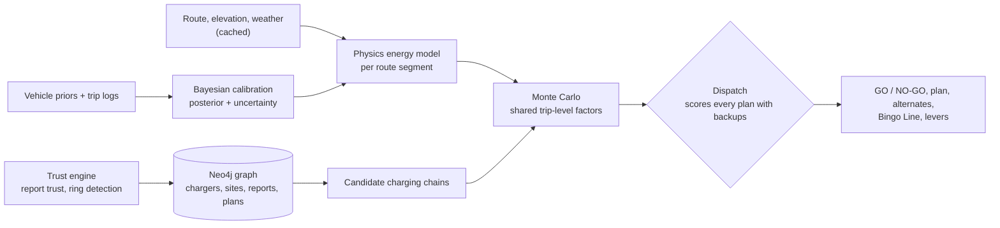

<div align="center">

# Verity

### Will I make it? An honest answer, with a confidence you can test.

Verity tells an EV driver whether they will reach their destination, how sure it is, and plans charging
around chargers that actually work.

[](https://github.com/Ansh-Goyal01/verity/actions/workflows/ci.yml)


[The idea](#the-idea) · [A release](#what-a-release-looks-like) · [How it works](#how-it-works) · [Evidence](#what-is-real-what-is-simulated) · [Run it](#run-it) · [API](#api) · [Docs](#documentation) · [Limits](#known-limits)

</div>

<!-- After deploy, add here: the 20-second demo GIF (first three beats), the link to the live driver app and its QR code.
     Nothing is deployed yet (see docs/DEPLOY.md), so no link is shown. -->

## The idea

An EV range number on a dashboard is a single guess. It ignores the AC load, the headwind, the hill, the driver, and
whether the charger you were counting on is actually working. A driver who is wrong ends up stranded.

Verity turns every trip into a **dispatch release**, the way an airline dispatcher releases a flight:

- **GO or NO-GO**, with a success probability the model actually computed, rounded to the nearest 5%.
- **A charging plan** with reachable **alternate chargers** if the planned one is broken.
- **The Bingo Line**: the battery % at each point of the route below which the driver must divert.
- **A point of no return**, and **levers** (slower cruise, more charging minutes, another vehicle) that raise confidence.
- **A refusal** when the evidence is too thin. Verity says so instead of promising.

## What a release looks like

Real output of `POST /api/dispatch` for the simulated demo vehicle V12, Noida to Agra
(`docs/api_examples/dispatch_V12.json`):

```text
decision            GO
confidence          95%+            1,500 Monte Carlo runs, model estimate, never shown as 100%
route               190.8 km, 177 min
arrival battery     p10 13%   p50 19%   p90 23%
charging stop       Tata Power Yamuna Expressway Mathura RHS, km 118.6, 30 min
bingo line          59% at km 0  ->  17% at km 96  ->  10% at km 190.8
point of no return  km 66
reason              GO because backup EV charging station (OpenStreetMap) (95%+ likely to work, 10 reports)
                    is reachable 90% of the time.
```

The vehicle and every charger report in this example are **simulated and labelled `is_simulated: true`**; the route,
elevation, weather and charger directory are real. The energy breakdown the driver sees (air drag, rolling
resistance, AC and electronics, climbs, regeneration) is the physics terms summed over the trip.

## How it works



| Principle | What it means here |
|---|---|
| **Physics first** | Energy is rolling resistance, grade, aero drag, inertia and auxiliary load per segment, so every term can be reported separately. Machine learning appears only as a baseline to beat (experiment E1). |
| **Shared trip-level uncertainty** | Driver style, AC use, payload, wind and capacity error are sampled once per simulated trip, not per segment. Sampling per segment makes long trips falsely confident (experiment E2 measures it). |
| **Trust-aware charging** | Charger reports are weighted by how reliable each source has proven (Dawid-Skene), and coordinated fake-report rings are detected. A stale or contested charger lowers the plan's confidence. |
| **The graph never decides alone** | Neo4j proposes candidate charging chains; the Monte Carlo, with backup plans, scores every one. |
| **Refuse rather than guess** | Thin evidence gives `INSUFFICIENT_EVIDENCE`, not a number. |
| **Honest labels** | Simulated data lives in `data/sim/`, every chart built from it says "(simulated)", and held-out trips are opened once. |

## What is real, what is simulated

Generated from the saved result files (`uv run python scripts/export_readme_tables.py`; a test fails when this is
stale). A count of 0 means nothing has been collected yet. The live version is `GET /api/evidence/ledger`.

<!-- readme-tables:start (generated by scripts/export_readme_tables.py; do not edit) -->
| Real evidence | Count |
|---|---|
| Indian trips, hand-collected from public sources | 0 usable of 6 rows |
| Charger reports (corpus + app snapshots) | 0 + 69 |
| Open Charge Map check-ins | 0 (fetched) |
| App reviews, classified | 0 usable of 0 |
| Voice notes from real speakers | 0 (not run) |
| BMW i3 trips, held out, opened once (Germany, not India) | 19 trips, 399 km |

| Simulated (every chart says so) | Trips or worlds per scenario |
|---|---|
| E3 reliability-blind vs trust-aware planning | 200 |
| E4 dispatch vs fixed stops | 200 |
| E5 trust recovery | 20 |
| E5b ring detection without a time window | 20 |
| E6 operator-correlated outages | 300 |

| Result | Data | n | Outcome |
|---|---|---|---|
| E4 stranded trips, 0% chargers down | simulated | 200 trips | fixed plan 9.0% (5.8% to 13.8%), dispatch 3.5% (1.7% to 7.0%) |
| E4 stranded trips, 20% chargers down | simulated | 200 trips | fixed plan 22.0% (16.8% to 28.2%), dispatch 2.0% (0.8% to 5.0%) |
| E4 stranded trips, 40% chargers down | simulated | 200 trips | fixed plan 32.0% (25.9% to 38.8%), dispatch 3.0% (1.4% to 6.4%) |
| E3 stranded trips, 40% chargers down | simulated | 200 trips | reliability-blind 12.5%, trust-aware 3.0% |
| E2 the 90% arrival band covers the outcome | simulated | 540 trips | shared trip factors 91.8%, independent segments 27.6% |
| BMW i3 usable-capacity error | REAL (Germany) | 19 trips | -10.5%; truth inside the 95% interval: yes, inside the 80% interval: no |
| BMW i3 battery drop per trip | REAL (Germany) | 19 trips | median error 0.95 points; the 95% band covers 47.0% of trips |
<!-- readme-tables:end -->

The simulator shares the planner's physics family, so simulated results are the optimistic case. Full provenance,
sources and the "do not claim" list are in [`docs/EVIDENCE.md`](docs/EVIDENCE.md).

## How Neo4j is used

Neo4j is optional: with no credentials, or `VERITY_GRAPH=memory`, an in-memory twin gives the same answers, and
`/api/health` says which one is running. Every graph response carries the Cypher it ran and its `query_ms`.

- Chargers, sites, operators, reports and plans are one graph (`engine/verity/trust/graph.py`, `graph_structure.py`).
  A charger's reports and trust: `GET /api/graph/charger/{id}`.
- The graph decides which backups are independent: chargers at the same site or run by the same operator share a
  cause of failure (`SHARED_CAUSES_CYPHER`). Candidate charging chains come from `chains_cypher`.
- Every plan is written back as a path, so a release can be audited: `GET /api/graph/why/{plan_id}`.
- Report rings (sources that agree too often) are found with Jaccard agreement edges (`AGREEMENT_CYPHER`); spoken
  charger names resolve through the `charger_names` full-text index.

## How Sarvam is used

Voice is optional too: without `SARVAM_API_KEY` the voice endpoints answer 503 and the pages fall back to the keypad.

- Speech to text and text to speech: `engine/verity/voice.py`; model ids are settings (`.env.example`).
- **Spoken ride-check** in Hindi or English: `POST /api/voice/ride-check`. It reads the request back and asks the
  driver to confirm before it decides anything.
- **Spoken charger report**: `POST /api/voice/report`, then `/report/confirm`. It needs consent and writes to the
  graph only after the driver confirms.
- Demo answers are cached as audio in `data/audio_cache/` and used only when Sarvam is unreachable (marked `cached: true`).

## Run it

Needs [uv](https://docs.astral.sh/uv/).

```bash
uv sync
uv run pytest
uv run start.py        # API on :8000, web pages on :5500, opens the product site
```

Optional services: copy `.env.example` to `.env` for Neo4j and Sarvam credentials (never committed). Without them the
engine runs on the in-memory graph and the voice endpoints answer 503. Everything from a clean state:
`uv run python scripts/run_all.py`. Every script and experiment is listed in [`docs/ENGINE_NOTES.md`](docs/ENGINE_NOTES.md).

## API

Interactive docs at `http://localhost:8000/docs`; the full contract is [`docs/API_CONTRACT.md`](docs/API_CONTRACT.md).

| Endpoint | What it does |
|---|---|
| `POST /api/dispatch` | The release: GO / NO-GO, plan, alternates, Bingo Line, levers |
| `POST /api/ride-check` | Cab-driver ride check with an after-drop charging plan |
| `POST /api/forecast/update` | Live update from a new mid-trip battery reading |
| `GET /api/chargers` | Chargers inside a bounding box, with trust and evidence |
| `GET /api/graph/why/{plan_id}` · `/api/graph/charger/{id}` | Audit a plan or a charger in the graph, with its Cypher |
| `POST /api/reports` | A charger report (consent, cooldown, rate limited) |
| `POST /api/voice/ride-check` · `/voice/report` | Spoken ride-check and charger report (Sarvam) |
| `GET /api/evidence/ledger` | What is real, simulated and still missing |
| `GET /api/health` | Which graph backend is running, voice key present |

```bash
curl http://localhost:8000/api/health
```

## Project structure

```text
engine/verity/   physics, vehicles, calibration, forecast (Monte Carlo), dispatch, routing,
                 chargers, voice, and trust/ (source trust, rings, the Neo4j and in-memory graph)
api/             FastAPI app, service layer and models that mirror the contract
scripts/         data import, benchmarks, evidence and snapshot exporters, run_all.py
experiments/     E1 to E6: learning curve, calibration, trust-aware planning, dispatch, trust recovery, rings
tests/           pytest suite, including the offline demo and graph parity tests
data/            corpus, simulated trips (sim/), fixed splits, processed route and charger data
results/         every experiment output the README and the UI quote
web/ logger/ design/   frontend: plain HTML, CSS and JS, no build step (read data only through the API)
docs/            see below
```

## Documentation

| Doc | Contents |
|---|---|
| [`API_CONTRACT.md`](docs/API_CONTRACT.md) | Every endpoint and shape, plus the change log |
| [`ENGINE_NOTES.md`](docs/ENGINE_NOTES.md) | Setup, every script and experiment, Sarvam API notes |
| [`EVIDENCE.md`](docs/EVIDENCE.md) | Results with n and intervals, real vs simulated, limits, sources |
| [`DATA.md`](docs/DATA.md) | Hand-collection guide for the Indian corpus, the BMW i3 dataset |
| [`DECISIONS.md`](docs/DECISIONS.md) | Every assumption, threshold and design choice, with the reason |
| [`DEPLOY.md`](docs/DEPLOY.md) | Hosting options and the offline fallback |
| [`COMPETITORS.md`](docs/COMPETITORS.md) | How existing EV apps compare |
| [`AI_USAGE.md`](docs/AI_USAGE.md) | Every AI tool and session, as the hackathon requires |
| [`PLAN.md`](docs/PLAN.md) | The original plan and research |

## Known limits

- There is no real Indian validation data yet. The three demo vehicles and every demo charger report are simulated and labelled.
- The one real evaluation is the BMW i3 (Germany, heater and AC load, not India). Its capacity estimate is low and the
  80% interval misses the truth (numbers in the table above), so the Range Passport capacity claim is not validated and stays in the lab.
- Operator-wide failure correlation (`BETA_OPERATOR = 0.2`) is an assumption, and E6 shows it makes no clear difference to stranding.
- Voice has been tested on synthetic audio only, not on real speakers, noise or accents; the 3-second goal has not been measured end to end.
- Almost no directory charger has tagged power, so dispatch assumes 25 kW.

## AI tool use

Every tool and session is disclosed in [`docs/AI_USAGE.md`](docs/AI_USAGE.md).

---

<div align="center">

Built for **hackFront India 2026**, problem T6.1 "Will I Make It". Team **Low Cortisol**.

</div>
